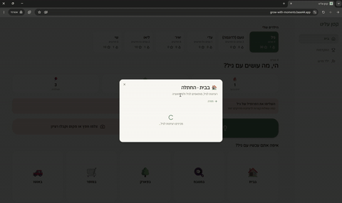

<div dir="rtl">

# 🌱 קטן עלינו (GrowWith)

**מערכת המלצות מותאמות אישית להורים לילדים מגיל לידה עד 6, שהופכת רגעי שגרה להזדמנויות להתפתחות.**



## האתגר

במהלך ההאקתון הקבוצה שלנו העלתה אתגר: הורים צעירים לא תמיד יודעים מה לעשות עם הילד ברגעי השגרה. איך עוזרים להם להפוך את היומיום להזדמנויות להתפתחות, בלי להוסיף עוד עומס?

## הפתרון

"קטן עלינו" מכירה את הילד דרך פרופיל אישי: גיל, תחומי עניין, אתגרים ושגרת יום. לפי הפרופיל היא מציעה פעילויות קצרות ופשוטות, מבוססות מחקר (AAP, CDC, WHO), שאפשר לעשות תוך דקות ובלי ציוד מיוחד. ההורה מקבל תזכורות בשעות שבחר. אפשר גם לצלם את הסיטואציה ולקבל רעיון שמתאים בדיוק לרגע. אחרי הפעילות ההורה מדווח ומדרג, ומקבל נקודות, רצף ימים ותגים שמעודדים להמשיך.

## פיצ'רים עיקריים

- **פרופיל ילד ותהליך הצטרפות**: גיל, שגרת יום, תחומי עניין של הילד וההורה, אתגר מרכזי ותחומי עדיפות (שפה, מוטוריקה, חברתי, רגשי, חשיבה, יצירתיות).
- **רעיונות לפי מקום ורגע**: בבית (החתלה, אכילה, לבוש, רחצה, סיפור, משחק), במטבח, בפארק, בסופר ובאוטו.
- **צילום מהיר**: מצלמים את המקום או החפץ, ו-AI מנתח את התמונה ומציע פעילות מתאימה.
- **טיפים לכל פעילות**: איך להתחיל, מה לומר ואיך להעמיק.
- **דיווח ומשוב**: דירוג, מעורבות הילד וחוויית ההורה.
- **גיימיפיקציה**: נקודות, רצף ימים ותגים (🌱 הצעד הראשון, 🔥 3 ימים ברצף, 🏆 25 פעילויות ועוד).
- **כמה ילדים ושני הורים**: אפשר להחליף בין ילדים, ושני ההורים רואים את אותו פרופיל.
- **מסך התקדמות** עם סיכום הפעילויות והתגים.
- ממשק בעברית ומימין לשמאל, מותאם למובייל.

## טכנולוגיות

| שכבה | כלים |
|------|------|
| Frontend | React, Vite, React Router, TanStack Query |
| עיצוב | Tailwind CSS, shadcn/ui (Radix UI), lucide-react |
| Backend | [Base44](https://base44.com): ישויות, הרשאות (RLS), אימות משתמשים |
| AI | פונקציות שרת (Deno) שקוראות ל-LLM דרך Base44 |

## מבנה הפרויקט

```
base44/
  entities/       # מודל הנתונים: Child, Activity, Report, User
  functions/      # פונקציות שרת
    suggestActivity/     # הצעת פעילות, כולל ניתוח תמונה
    generateActivities/  # יצירת סט פעילויות לפי פרופיל הילד
    placeIdeas/          # רעיונות לפי מקום ורגע בשגרה
    activityTips/        # טיפים להורה לכל פעילות
src/
  pages/          # Landing, Home, Onboarding, Progress, Login, Register...
  components/     # רכיבי האפליקציה (onboarding/, ui/ ועוד)
  hooks/          # useChildren, useReminders
  lib/            # gamification.js (נקודות, רצף, תגים), places.js (מקומות ורגעים)
docs/
  demo.gif        # סרטון הדגמה
```

## הרצה מקומית

דרישות: [Node.js](https://nodejs.org), [Deno](https://docs.deno.com/runtime/getting_started/installation/) ו-Base44 CLI.

</div>

```bash
npm install
npm install -g base44@latest
base44 login   # once per machine
base44 link    # once per clone
base44 dev     # local backend + frontend
```

<div dir="rtl">

אחר כך פותחים את הכתובת ש-`base44 dev` מדפיס (בדרך כלל `http://localhost:5173`).

הערות:
- `base44 link` כותב את הקובץ `base44/.app.jsonc`, שלא נשמר ב-git. צריך להריץ אותו בכל clone חדש.
- אין להריץ `npm run dev` לבד, כי בלי `base44 dev` אין backend וכל קריאות ה-API נכשלות.
- ב-`base44 dev` הנתונים נשמרים בזיכרון ונמחקים בכל הפעלה מחדש. כדי לעבוד מול ה-backend המקורי משתמשים ב-`base44 dev --remote`, אבל אז הכתיבה נעשית לנתוני ה-production.

מידע נוסף: [תיעוד Base44 לפיתוח מקומי](https://docs.base44.com/developers/backend/overview/local-dev/local-development-overview)

## הערה

האפליקציה מציעה רעיונות לפעילות בלבד, ואינה מחליפה ייעוץ או אבחון מקצועי.

</div>
